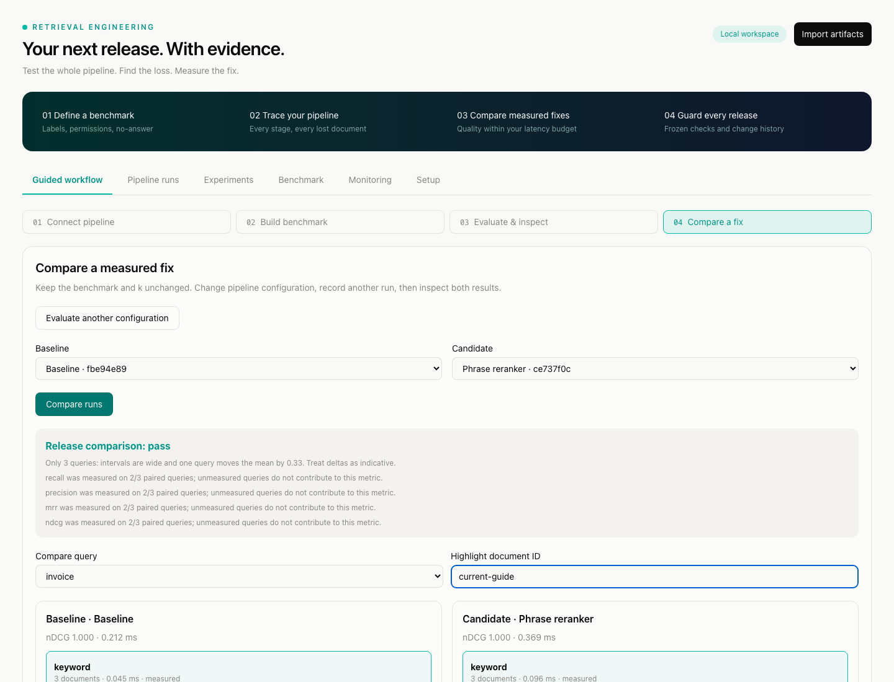

# Vectraudit

**Test your pipeline. Explain failures. Measure fixes. Guard every release.**

[](https://github.com/rmnvg/Vectraudit/actions/workflows/ci.yml)

> **Proprietary and confidential.** Vectraudit (formerly faissight) is a commercial product,
> distributed privately and not published to PyPI.

Vectraudit tells you whether a change to your retrieval system made it better or worse,
and why. It measures baseline and candidate retrieval on the same versioned, labelled
questions. It traces where each relevant document was lost and checks permission and
no-answer behavior. Every decision is backed by query-level evidence. Evaluation runs on
your infrastructure; only run files are uploaded, and only if you choose to.

There are three ways to use it:

| | For | Start with |
|---|---|---|
| **[Retrieval workbench](#retrieval-workbench)** | Building a benchmark, evaluating a whole pipeline, comparing a fix in the browser | `vectraudit workbench serve` |
| **[Release checks](#release-checks)** | Blocking regressions in CI on FAISS, Qdrant, pgvector, Pinecone or Weaviate | `vectraudit init` |
| **[FAISS index debugger](#faiss-index-debugger)** | Explaining missed neighbours, quantization loss and recall vs latency inside one index | `vectraudit serve INDEX` |

Results can also go to the [hosted control plane](docs/cloud-operations.md) for pinned
baselines, history, reports and pull-request checks.

## Install

Install a wheel from a private release (see [docs/RELEASING.md](docs/RELEASING.md)), or
from a checkout with `uv sync --all-extras` and prefix the commands below with `uv run`:

```bash
pip install "./vectraudit-0.1.0-py3-none-any.whl[all]"
```

Extras install only the backends you use: `[faiss-cpu]`, `[qdrant]`, `[pgvector]`, `[weaviate]`.
Pinecone needs no extra. `[text]` adds sentence-transformers for text queries, and `[cloud]`
adds the hosted control plane's dependencies. `[all]` includes everything except the
optional LLM labelling helper (`[label-llm]`).

## Retrieval workbench

Test the whole pipeline, not just the index: query rewriting, hybrid retrieval, filters,
rerankers and permissions. The workbench runs locally and opens on a guided workflow:

```bash
vectraudit workbench serve workbench-runs   # opens http://127.0.0.1:8766
```

1. **Connect a pipeline:** the built-in BM25/hybrid baseline over a JSONL corpus, your
   existing [LangChain or LlamaIndex retriever](docs/retrieval-workbench.md#langchain-and-llamaindex-retrievers),
   or Python and HTTP adapters registered at startup with `--manifest pipelines.json`.
2. **Build a benchmark:** questions, relevance grades, explicit no-answer judgments, tenant
   context, filters, forbidden documents, cohort tags and an exploratory/held-out split.
   Read local passages and click grades, preview CSV/JSON imports, or build permission
   scenarios. Freeze versions and review labels when documents change.
3. **Evaluate and inspect:** a cancellable local run records each stage's results.
   Follow any document through every stage to the one where it was lost.
4. **Compare a fix:** run a candidate configuration, get a release verdict, and step
   through both runs' traces side by side. Track a finding, record investigation notes,
   and verify a later fix against the same comparison suite.

Use **Use starter example** for a first run in under a minute. Held-out queries stay out of
exploratory runs and need explicit confirmation, so tuning doesn't contaminate them.



The same engine runs from the command line for automation: bounded optimization with one
held-out validation, benchmark audits (duplicates, missing categories, judgment queues)
and scheduled monitoring against a frozen baseline.

```bash
vectraudit workbench run examples/workbench/manifest.json --out workbench-runs
vectraudit workbench optimize examples/workbench/manifest.json --out workbench-runs/optimization.json
vectraudit workbench benchmark examples/workbench/queries.jsonl --runs workbench-runs
vectraudit workbench monitor manifest.json baseline.run.json
```

Evaluations save query progress locally. Resume from **Saved progress** in the browser
or use `workbench run --resume CHECKPOINT_DIRECTORY`; failed-query retries are explicit.
See [recovery details](docs/retrieval-workbench.md#resume-an-evaluation).

See the [workbench guide](docs/retrieval-workbench.md) for adapter manifests, stage
evidence, no-answer and permission assertions, and data-handling boundaries.

## Release checks

Measure a baseline and a candidate retrieval setup on the same labelled queries, and let CI
decide: pass, fail, error or not comparable.

```bash
vectraudit init --backend qdrant          # or faiss, pgvector, pinecone, weaviate
vectraudit doctor --connection retrieval/connection.json --dataset retrieval/dataset.jsonl --policy retrieval/policy.json
vectraudit record --connection main.json --dataset dataset.jsonl --out baseline.json --label main
vectraudit record --connection pr.json   --dataset dataset.jsonl --out candidate.json --label pr-42
vectraudit check baseline.json candidate.json --policy policy.json --html report.html
```

`init` scaffolds a connection, policy, query sheet and GitHub workflow. `doctor` inspects
the setup offline without loading a model or opening a database connection. `check` exits 0
(pass), 1 (error), 3 (fail) or 4 (not comparable), writes the GitHub job summary, and the
HTML report lists the regressed queries with the ids they lost.

Semantic metrics (recall, precision, MRR, nDCG) need relevance labels; ANN recall needs an
exact reference; neither is ever substituted for the other. Failing checks explain
themselves: each finding is marked verified, supported or hypothesis, with the facts behind
it. Credentials are referenced by environment variable and never written into config files.

| Backend | Connector | Extra |
|---|---|---|
| FAISS | index file | `[faiss-cpu]` |
| Qdrant | collection | `[qdrant]` |
| pgvector | table and columns in PostgreSQL | `[pgvector]` |
| Pinecone | index over HTTPS | none |
| Weaviate | collection | `[weaviate]` |

Already have a benchmark? `vectraudit dataset import` reads BEIR, TREC qrels, Ragas test
sets, DeepEval goldens and LangSmith/Langfuse exports ([formats](docs/release-checks.md#bringing-labels-you-already-have)).
No labels yet? The [local labelling assistant](docs/labelling.md) (`vectraudit label`)
pools candidate documents from your questions and source corpus, then supports blind
second passes, agreement and reviewer resolution before export. Choosing a setup
before you guard it? [Experiments](docs/experiments.md) (`vectraudit experiment`) compare
embedding models, chunkings and indexes on one labelled set.

- [Your first release check in 15 minutes](docs/first-check.md)
- [Release-check guide](docs/release-checks.md): dataset, connection and policy formats
- [Setup diagnostics](docs/doctor.md): `vectraudit doctor` for text-only queries and CI
- [Pull-request workflow](examples/github/retrieval-check.yml) with check runs and comments
- [Case study: a latency fix that quietly broke retrieval](docs/case-study-nprobe.md)
- [Case study: choosing an embedding model and chunk size](docs/case-study-experiment.md)

## FAISS index debugger

For FAISS users, a local UI explains what happens inside one index: which true neighbours
the search missed and why, how much quantization costs, how balanced the lists are, and the
cheapest setting that reaches your recall target.

```bash
vectraudit demo                       # builds a real RAG demo once (~1 min), opens the UI
vectraudit serve my.index --vectors vectors.npy --meta chunks.jsonl
```

`vectraudit demo` downloads 12,000 public passages, embeds them with `all-MiniLM-L6-v2` and
builds IVF-Flat, IVF-PQ and HNSW indexes. Type a question and see which true neighbours
the index missed, and why.


| View | What it shows |
|---|---|
| **Query explorer** | Search by text, stored id or vector. Compares with exact ground truth and gives a reason for every missed neighbour: *cell not probed*, *quantization*, *transform* (PCA/OPQ), or *ranked out*, plus the smallest nprobe that finds them all. |
| **Tuner** | Recall@k and latency across nprobe or efSearch, the cheapest value for your target recall, the worst queries, and suggested next steps backed by the measurements. |
| **Compare** | Two indexes over the same vectors on identical queries: recall with intervals, mean/p95 latency, serialized size, and which queries' neighbours changed. |
| **HNSW graph** | The layers of an HNSW graph and an animated, step-by-step replay of the search. |
| **Quantization** | How far PQ/SQ codes are from your raw vectors and how much they distort near-neighbour distances. |
| **Overview** | Inverted-list sizes and imbalance, with a **Diagnose my index** guide. |
| **Cluster map** | Stored vectors projected with PCA or UMAP (2D/3D), with IVF centroids. |
| **Relevance** | Recall, MRR and nDCG@k from labelled judgements, before and after exact reranking. |
| **Run history** | Saved sweeps, comparisons and evaluations kept across restarts. |

<table>
<tr>
<td></td>
<td></td>
</tr>
<tr>
<td></td>
<td></td>
</tr>
</table>

| Index | Support |
|---|---|
| `IndexFlat` (L2 / IP) | search, map, ground truth |
| `IndexIVFFlat`, `IndexIVFPQ`, `IndexIVFScalarQuantizer` | everything: list balance, probe trace, miss reasons, tuner, quantization |
| `IndexHNSWFlat`, `IndexHNSWSQ`/`PQ` | graph view, search trace, tuner (efSearch), quantization for SQ/PQ storage |
| Wrappers: `IndexIDMap`/`IDMap2`, `IndexPreTransform` (PCA, OPQ), `IndexRefine` | unwrapped transparently; ids stay yours |
| Binary, GPU, IVF FastScan, others | basic stats only (convert GPU indexes with `faiss.index_gpu_to_cpu`) |

From Python or Jupyter (JupyterLab, VS Code notebooks and Colab; see [Jupyter notes](docs/jupyter.md)):

```python
import vectraudit

viewer = vectraudit.launch(index, vectors=xb, metadata=chunks)  # any faiss.Index
report = viewer.session.query(id=42, k=10, nprobe=4)
report.recall, report.ivf_trace.min_nprobe_for_all
```

The [FAISS debugger reference](docs/faiss-debugger.md) covers inputs, labelled relevance,
every command-line option (`serve`, `sweep`, `compare`, `evaluate`, `runs diff`, `cache`),
saved baselines, measurement methodology, caching and limitations.

## Hosted service and deployment

- [Running Vectraudit Cloud](docs/cloud-operations.md): hosted baselines, history, reports
  and the dashboard (`vectraudit record --upload`, `check cloud:main --upload`), with
  plain-language release summaries and quality trends for the lead (`cloud summary`)
- [Enterprise deployment](docs/enterprise-deployment.md): local, private-runner and hosted
  profiles, SSO, roles and recovery
- [Threat model](docs/threat-model.md) and [incident response](docs/incident-response.md)
- [Launch readiness](docs/launch-readiness.md): validation and pilot acceptance evidence
- [Pilot release rehearsal](docs/pilot-release-validation.md): reproduce an improving-average
  regression, inspect a critical repeat failure, and verify the fix through exported checks
- [Reference support search](examples/reference_search/README.md): measure a real BM25/filter
  regression on fictional documents, compare independent application revisions, and inspect
  the exported reports (proposed labels await human review)

## Development

```bash
git clone https://github.com/rmnvg/Vectraudit && cd Vectraudit
uv sync --all-extras
cd frontend && npm install && npm run build && cd ..
uv run pytest && uv run ruff check . && uv run mypy
uv run python examples/make_synthetic.py && uv run vectraudit serve examples/data/ivf_pq.index --vectors examples/data/vectors.npy
```

Frontend development: run `npm run dev` in `frontend/` next to a running `vectraudit serve`.
The frontend's API types are generated from the server's OpenAPI schema; after changing
`server/schemas.py`, run `uv run python scripts/generate_api_types.py` (CI fails on drift).
After adding or upgrading a frontend runtime dependency, run
`node scripts/third-party-notices.mjs` in `frontend/` to refresh
`src/vectraudit/THIRD_PARTY_NOTICES.txt`, which ships in the wheel (CI fails on drift).
Browser tests run on Chromium, Firefox and WebKit: `npx playwright install chromium firefox
webkit`, build the UI, then `npm run e2e` in `frontend/`. The workbench journeys run with
`node scripts/workbench_smoke.mjs` and `node scripts/guided_smoke.mjs`.
Design decisions are logged in [docs/DECISIONS.md](docs/DECISIONS.md).

## License

Proprietary. Copyright (c) 2026 Ramanjot Singh. All rights reserved; use requires a written
agreement. See [LICENSE](LICENSE). The demo corpus is "RAG Dataset 12000" by Neural Bridge AI
(Apache-2.0), with passages from Falcon RefinedWeb (ODC-By 1.0).
