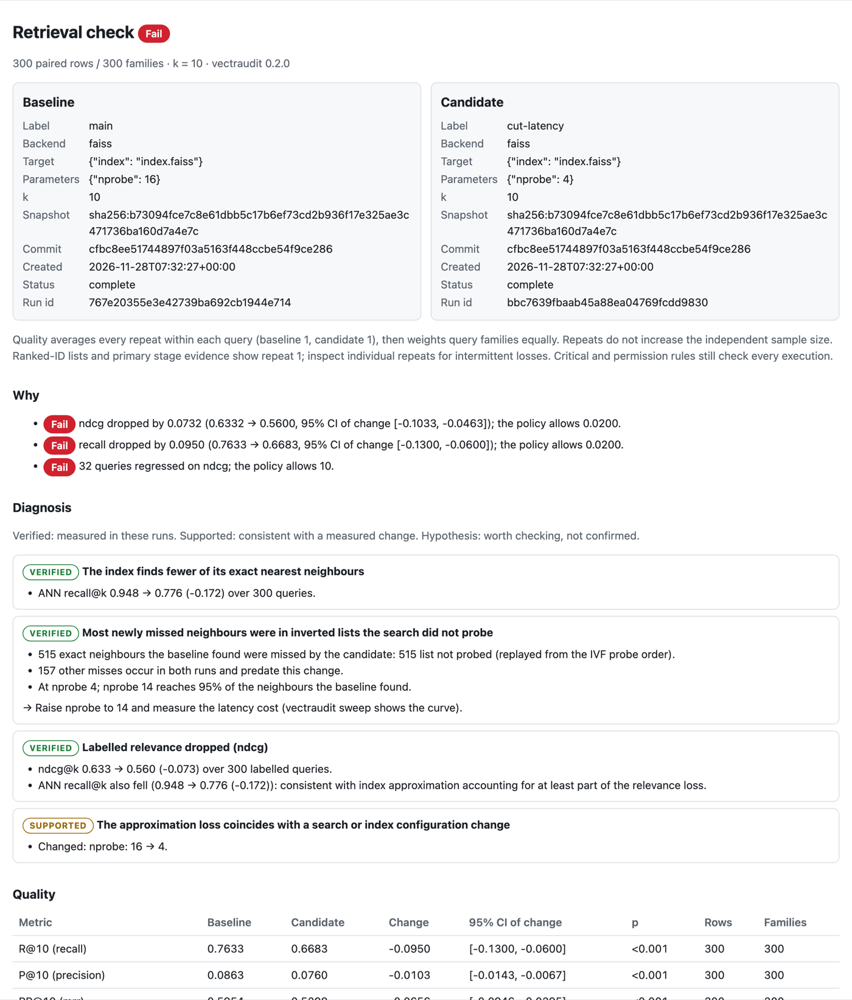
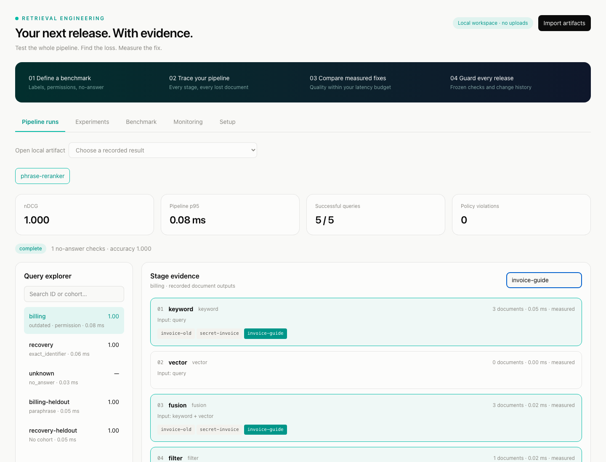

# Vectraudit

**Catch retrieval regressions before they merge.**

[](https://github.com/rmnvg/Vectraudit/actions/workflows/ci.yml)
[](https://github.com/rmnvg/Vectraudit/blob/main/LICENSE)

A changed embedding model, chunk size, index setting or reranker can make your RAG or search
system worse without breaking a single test. Vectraudit runs your labelled questions against
the current and the proposed retrieval setup on every pull request, and fails the check when
results get worse beyond your policy. The report says why: which questions regressed, which
documents they lost, and where along the way they were lost.

```bash
vectraudit init --backend qdrant     # or faiss, pgvector, pinecone, weaviate, elasticsearch, opensearch, chroma
vectraudit record --connection retrieval/connection.json --dataset retrieval/dataset.jsonl --out baseline.json
# change the index, model, chunking or a search setting, then record the candidate
vectraudit record --connection retrieval/connection.json --dataset retrieval/dataset.jsonl --out candidate.json
vectraudit check baseline.json candidate.json --policy retrieval/policy.json --html report.html
```

**Try it in 10 minutes:** the [quickstart](https://github.com/rmnvg/Vectraudit/blob/main/docs/quickstart.md)
builds an index from a public benchmark, catches a search setting that quietly drops
nDCG@10 from 0.63 to 0.56, and puts the same check on your pull requests.



It runs on your infrastructure and needs only read access to your vector store; nothing is
uploaded unless you host the optional control plane
([security and data handling](https://github.com/rmnvg/Vectraudit/blob/main/docs/security.md)).

## Install

```bash
pip install "vectraudit[all]"
```

The same wheel, with the built web UI, is attached to each
[GitHub release](https://github.com/rmnvg/Vectraudit/releases) with its `SHA256SUMS`; the CI
workflow written by `vectraudit init` installs it from there, pinned by version and hash:

```bash
pip install "vectraudit[all] @ https://github.com/rmnvg/Vectraudit/releases/download/v0.2.0/vectraudit-0.2.0-py3-none-any.whl"
```

Extras install only what you use: the backends `[faiss-cpu]`, `[qdrant]`, `[pgvector]` and
`[weaviate]` (Pinecone, Elasticsearch, OpenSearch and Chroma need none), `[text]` for
sentence-transformers text queries, `[umap]`, `[parquet]`, `[hdf5]` and `[cloud]` for the
self-hosted control plane. `[all]` has everything except the LLM labelling helper
(`[label-llm]`). Python 3.10 to 3.13.

## How a release check works

1. `init` scaffolds a connection, a release policy, a query sheet and a GitHub workflow.
2. You label 30 or more real questions with the documents that answer them, or import labels
   you already have (BEIR, TREC qrels, Ragas, DeepEval, LangSmith, Langfuse and others).
3. `record` runs the questions against a backend and writes a run file; `check` compares a
   baseline run with a candidate under the policy and exits 0 (pass), 1 (error), 3 (fail) or
   4 (not comparable).
4. In CI, every pull request that touches retrieval records the target branch and the pull
   request on the same runner and gets a check run, a summary comment and an HTML report.

Quality metrics (recall, precision, MRR, nDCG, MAP, hit rate) come from relevance labels and
are tested to equal `trec_eval`'s; ANN recall comes from an exact reference; one is never
substituted for the other. Each finding in a failing check is marked verified, supported or
hypothesis, with the facts behind it, and `check --bundle` writes evidence a reviewer outside
the team can verify offline. A check can also be one more pytest test
(`vectraudit.testing.assert_release`).

| Backend | Connector | Extra | Tested in CI against |
|---|---|---|---|
| FAISS | index file | `[faiss-cpu]` | faiss-cpu from the lockfile |
| Qdrant | collection | `[qdrant]` | the client's local mode (no server) |
| pgvector | table and columns in PostgreSQL | `[pgvector]` | pgvector 0.8.7 on PostgreSQL 17 and 18 |
| Pinecone | index over HTTPS | none | Pinecone Local v1.0.0.rc0 |
| Weaviate | collection | `[weaviate]` | 1.32.4 and 1.41.0 |
| Elasticsearch / OpenSearch | index with a `dense_vector` / `knn_vector` field | none | Elasticsearch 8.15.3 and 9.5.7, OpenSearch 2.17.1 and 3.10.1 |
| Chroma 1.x | collection over the v2 REST API | none | 1.5.9 |

Each pull request that touches a connector runs its live tests against the oldest and newest
server versions above, and a nightly run follows each project's newest release. LangChain
and LlamaIndex retrievers, and any Python or HTTP pipeline, can be measured too.

## What else it does

The release check is the part most teams start with. The same labelled questions power the
rest:

| You want to | Vectraudit gives you | Guide |
|---|---|---|
| **Build and maintain a benchmark** | Guided labelling with grades, no-answer and permission cases, held-out splits and frozen versions; imports from BEIR, TREC, MTCB, Ragas, DeepEval, LangSmith and Langfuse; a label audit that finds labels likely to be wrong | [Labelling](https://github.com/rmnvg/Vectraudit/blob/main/docs/labelling.md), [integrations](https://github.com/rmnvg/Vectraudit/blob/main/docs/integrations.md) |
| **Evaluate a whole pipeline** | Stage-by-stage traces, the stage where each document was lost, a per-component scoreboard, side-by-side comparison of a fix | [Retrieval workbench](https://github.com/rmnvg/Vectraudit/blob/main/docs/retrieval-workbench.md) |
| **Measure what is in production** | Runs built from OpenInference, OpenTelemetry, Phoenix, Langfuse, LangSmith, Opik and OpenObserve traces; answer judgments from your evaluation tools; a review queue of new questions; question, embedding and score drift | [Production traces](https://github.com/rmnvg/Vectraudit/blob/main/docs/retrieval-workbench.md#from-production-traces-and-the-tools-you-already-use), [intake](https://github.com/rmnvg/Vectraudit/blob/main/docs/production-intake.md) |
| **Explain a failure** | Investigation of one question, declared fixes tried and validated on held-out data, lineage and freshness, permission lifecycle, fusion replay, claim-level evidence | [Investigate deeper](https://github.com/rmnvg/Vectraudit/blob/main/docs/retrieval-workbench.md#investigate-deeper) |
| **Choose a setup** | Embedding models, chunkers and indexes compared on one labelled set; recall under filters; capacity under concurrent load; migration reports | [Experiments](https://github.com/rmnvg/Vectraudit/blob/main/docs/experiments.md), [capacity](https://github.com/rmnvg/Vectraudit/blob/main/docs/capacity.md), [migration](https://github.com/rmnvg/Vectraudit/blob/main/docs/migration-report.md) |
| **Check safety** | Permission and tenant assertions, cache-leak probes, corpus scans for injected instructions, poisoning checks | [Permissions](https://github.com/rmnvg/Vectraudit/blob/main/docs/permission-lifecycle.md), [poisoning](https://github.com/rmnvg/Vectraudit/blob/main/docs/poisoning.md) |
| **Tune a search setting on any backend** | The cheapest `hnsw_ef`, `ef_search`, `num_candidates` or `probes` that reaches your recall target against an exact reference, the neighbours each query missed, filtered and batch curves | [Tuning](https://github.com/rmnvg/Vectraudit/blob/main/docs/tuning.md) |
| **See inside a FAISS index** | Missed neighbours and why, quantization loss, HNSW search replay, recall against latency, LangChain and LlamaIndex FAISS folders | [FAISS debugger](https://github.com/rmnvg/Vectraudit/blob/main/docs/faiss-debugger.md) |
| **Share results with a team** | Pinned baselines, history, reports and pull-request checks on a control plane you host yourself | [Control plane](https://github.com/rmnvg/Vectraudit/blob/main/docs/cloud-operations.md) |



## Documentation

The [documentation index](https://github.com/rmnvg/Vectraudit/blob/main/docs/README.md) lists
every guide. Start with:

- [Quickstart](https://github.com/rmnvg/Vectraudit/blob/main/docs/quickstart.md): a red and a green pull-request check on a public benchmark in 10 minutes
- [Your first release check](https://github.com/rmnvg/Vectraudit/blob/main/docs/first-check.md) on your own backend, and the [release-check guide](https://github.com/rmnvg/Vectraudit/blob/main/docs/release-checks.md) for every format and policy option
- [Case study: a latency fix that quietly broke retrieval](https://github.com/rmnvg/Vectraudit/blob/main/docs/case-study-nprobe.md)
- [Security and data handling](https://github.com/rmnvg/Vectraudit/blob/main/docs/security.md)

## Contributing

Bug reports, documentation fixes and pull requests are welcome; see
[CONTRIBUTING.md](https://github.com/rmnvg/Vectraudit/blob/main/CONTRIBUTING.md) for the
development setup and checks. Report security problems privately as described in
[SECURITY.md](https://github.com/rmnvg/Vectraudit/blob/main/SECURITY.md).

## License

Licensed under the [Apache License 2.0](https://github.com/rmnvg/Vectraudit/blob/main/LICENSE);
see also [NOTICE](https://github.com/rmnvg/Vectraudit/blob/main/NOTICE). Nothing runs from
the projects Vectraudit learns from (ranx, trec_eval, MTEB, RAGChecker and others): their
methods are reimplemented and [credited](https://github.com/rmnvg/Vectraudit/blob/main/docs/credits.md),
and no dataset is ever downloaded for you. The demo corpus is "RAG Dataset 12000" by Neural
Bridge AI (Apache-2.0), with passages from Falcon RefinedWeb (ODC-By 1.0).
