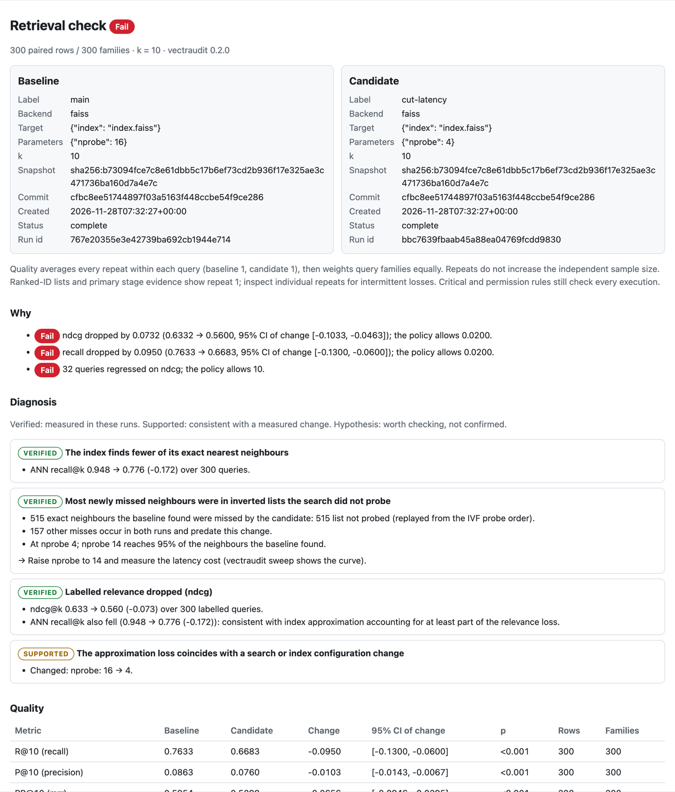

# Quickstart: block a retrieval regression in 10 minutes

You will build a small vector index from a public benchmark, catch a change that quietly
makes search worse, then put the same check on your pull requests so it goes red on that
change and green on a good one.

You need Python 3.10+ and about 2 GB of disk (the embedding model brings PyTorch). The last
step needs a GitHub account and the [`gh` CLI](https://cli.github.com/).



## 1. Install (3 minutes)

```bash
mkdir retrieval-quickstart && cd retrieval-quickstart && git init
python -m venv .venv && source .venv/bin/activate
pip install "vectraudit[faiss-cpu,text]"
```

`text` adds sentence-transformers for embedding; your CI only needs `faiss-cpu`.

## 2. Get a labelled benchmark (1 minute)

[SciFact](https://github.com/allenai/scifact) has 5,183 scientific abstracts and 300 test
claims, each labelled with the abstracts that support or refute it. Vectraudit never
downloads data for you, so fetch it from the BEIR mirror:

```bash
curl -fsSLO https://public.ukp.informatik.tu-darmstadt.de/thakur/BEIR/datasets/scifact.zip
unzip -q scifact.zip && rm scifact.zip
printf 'scifact/\nruns/\n*.html\n' > .gitignore
```

SciFact is released by its authors under CC BY-NC 2.0. That is fine for this tutorial; keep
the repository private or credit the dataset if you publish it.

## 3. Build the index (1 minute)

The [build script](../examples/quickstart/build_index.py) embeds every abstract with
all-MiniLM-L6-v2 and writes an IVF index (64 lists) keyed by the SciFact ids, plus the raw
vectors so the check can also measure the index against exact search:

```bash
curl -fsSLO https://raw.githubusercontent.com/rmnvg/Vectraudit/main/examples/quickstart/build_index.py
python build_index.py scifact --out retrieval/index
```

## 4. Scaffold and label (1 minute)

```bash
vectraudit init --backend faiss
cat > retrieval/connection.json <<'EOF'
{
  "backend": "faiss",
  "name": "scifact ivf",
  "index": "index/index.faiss",
  "vectors": "index/vectors.npy",
  "ids": "index/ids.npy",
  "params": {"nprobe": 16}
}
EOF
vectraudit dataset import scifact --format beir --split test --out retrieval/dataset.jsonl
vectraudit dataset embed retrieval/dataset.jsonl --model sentence-transformers/all-MiniLM-L6-v2 --normalize
```

`init` writes the connection, a release policy, a GitHub workflow and its two actions.
The connection's paths are relative to `retrieval/`. The import keeps the 300 test claims
that have labels, and `embed` stores their query vectors in the dataset, so CI never loads
the model. The policy lets nDCG@10 and recall@10 drop by at most 0.02 and at most 10
questions regress.

## 5. Catch a regression locally (1 minute)

Someone lowers `nprobe` from 16 to 4 to make search faster. Record both setups on the same
questions and check:

```bash
vectraudit record --connection retrieval/connection.json --dataset retrieval/dataset.jsonl --out baseline.json --label main
vectraudit record --connection retrieval/connection.json --dataset retrieval/dataset.jsonl --out candidate.json --label nprobe-4 --param nprobe=4
vectraudit check baseline.json candidate.json --policy retrieval/policy.json --html report.html
```

```text
FAIL · 300 paired queries
  • ndcg dropped by 0.0732 (0.6332 → 0.5600, 95% CI of change [-0.1033, -0.0463]); the policy allows 0.0200.
  • recall dropped by 0.0950 (0.7633 → 0.6683, 95% CI of change [-0.1300, -0.0600]); the policy allows 0.0200.
  • 32 queries regressed on ndcg; the policy allows 10.
```

`check` exits 3. `report.html` explains why: the index now misses 17% of the neighbours exact
search finds, and the neighbours it newly misses sit in inverted lists that were not probed.
It suggests the smallest `nprobe` that recovers them. Its tables show the 32 claims that got
worse and the abstracts they lost. Try `--param nprobe=32` for the candidate and the check
passes (exit 0). The latency rule ignores rises under 2 ms, so a sub-millisecond index's
jitter is not a regression.

## 6. Put it on your pull requests (3 minutes)

The workflow installs the Vectraudit release wheel, pinned by version and SHA-256. Fill in
the hash from the release's `SHA256SUMS`, then publish the repository:

```bash
v=$(python -c "import vectraudit; print(vectraudit.__version__)")
sha=$(curl -fsSL "https://github.com/rmnvg/Vectraudit/releases/download/v$v/SHA256SUMS" | cut -d' ' -f1)
sed -i.bak "s/REPLACE_WITH_64_HEX_SHA256/$sha/" .github/workflows/retrieval-check.yml && rm .github/workflows/*.bak
rm -f baseline.json candidate.json build_index.py
git add . && git commit -m "Retrieval check on SciFact"
gh repo create retrieval-quickstart --private --source . --push
```

The index and dataset add about 18 MB to the repository. Then open the regressing change
as a pull request:

```bash
git switch -c faster-search
sed -i.bak 's/"nprobe": 16/"nprobe": 4/' retrieval/connection.json && rm retrieval/connection.json.bak
git commit -am "Lower nprobe to 4 for latency" && git push -u origin faster-search
gh pr create --fill
```

The **Retrieval check** job records `main`'s connection and the pull request's on the same
runner and fails. The pull request gets a failing check with the reasons above and one
summary comment, and the HTML report is kept as a workflow artifact. Push the fix and the
same comment turns green:

```bash
sed -i.bak 's/"nprobe": 4/"nprobe": 32/' retrieval/connection.json && rm retrieval/connection.json.bak
git commit -am "Raise nprobe to 32 instead" && git push
```

## Next: your own system

Replace the three inputs with yours, and nothing else changes:

- **Connection:** `vectraudit init --backend qdrant` (or `pgvector`, `pinecone`, `weaviate`,
  `elasticsearch`, `opensearch`, `chroma`) writes a template. Put credentials in
  environment variables and repository secrets; see
  [your first release check](first-check.md).
- **Questions:** 30 or more real user questions with the ids of the documents that answer
  them. `dataset import` reads a CSV, BEIR, TREC qrels and several evaluation tools'
  exports ([formats](release-checks.md#bringing-labels-you-already-have)); without labels,
  the [labelling assistant](labelling.md) gets you a first set in about 30 minutes.
- **Policy:** start from the scaffolded one, then measure your system's run-to-run noise
  with `vectraudit calibrate` before tightening it ([calibration](release-checks.md#calibrate-the-policy-a-a)).
